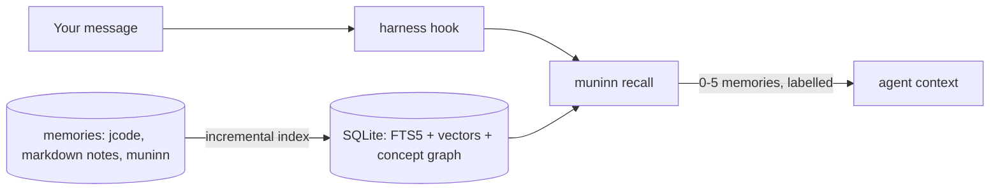

<p align="center"></p>

# muninn

**Local-first memory recall for AI coding agents.** muninn indexes your memories
on your own machine and injects the few that matter into the agent's context,
automatically, before it answers. Recall needs no account, API key or remote
service. Optional automatic capture calls your configured model provider and
requires its credentials. Capture is opt-in and keeps a private, local audit.

## What's new in v0.4.0

- Short memory IDs and strict instance, project and client scoping.
- Compact SDD recall rows with the shipped date, ID and note columns.
- Opt-in capture with resumable bounded hooks, category/trust decisions and
  `muninn capture log` / `stats` for a private 30-day audit.
- Project memories shared on `muninn-notes`, mounted at `.muninn-notes/`,
  independently of your code branch. Preview legacy migration with
  `muninn sync --migrate --dry-run`.

See [CHANGELOG.md](CHANGELOG.md) and [capture documentation](docs/CAPTURE.md).

It works with **jcode**, **Claude Code** and **Codex** through their hooks, with
any MCP client through `muninn mcp`, and it has a local **web UI** and a **TUI**.
One static binary for macOS, Linux and Windows (arm64 and amd64).

> Muninn is Odin's raven of memory: it flies out every morning and brings back
> what matters.

## Deliberate cleanup with `muninn tidy`

`tidy` is an owner CLI tool, never a hook, MCP tool, TUI action or web route.
It reads the existing index without rewriting dated notes or revalidating their
historical truth. These terms distinguish its evidence:

- **Similarity neighborhood**: a memory's stored corpus-wide kNN neighbors
  (`neighbors`, with similarity), not a topic or client group.
- **Topic group**: an existing corpus-wide Louvain community of concepts
  (`concepts`, `communities`, `unit_communities`). Tidy reuses it, never rebuilds it.
- **Client group**: a topic group that mostly belongs to one scope.

```sh
muninn tidy scan                         # read-only scan, private JSON + Markdown
muninn tidy scan --judge --max-judge 40  # optional configured extract model
# Review the printed plan path. Unjudged entries are unsure, not move decisions.
muninn tidy apply /path/to/plan.json --dry-run
muninn tidy apply /path/to/plan.json --only 'global->client:example'
```

Defaults are `--min-sim 0.70 --majority 10 --own-max 3`, plus
`--group-purity 0.6666666666666666 --group-min 5 --group-floor 0.0024 --group-score 3`.
Top scope is computed from the **effective recall scope**, using the same
physical-source client-root resolution as `Binding.ScopeFor`: a non-native
source under a `.muninn/client` root belongs to that `client:<name>`, even if its
stored label is `jcode@...:<folder>`. Native memories retain their stored scope.
Invalid client markers fail the scan closed. A source file symlink is resolved
before walking its physical ancestors. No move is proposed to the effective
source's own top scope. Client ownership is immutable provenance, not a topic
guess: a client memory can only target that client's concrete child scopes, never
another client or a non-client scope. Non-client memories cannot enter clients
based on similarity. Blocked proposals are dropped before judging and counted.

Top scope is `client:<name>` with child scopes dropped, otherwise the part before
the first colon (including `project` for `project:<id>`). `folder:<path>` stays
its own place, even when the path contains colons. These are counting buckets,
not move targets: every target must be an existing effective, concrete writable
scope. The concrete scope with the most qualifying voting neighbors within the
winning bucket is selected, with lexical ties. Group-only proposals with several
possible concrete targets and zero concrete votes are suppressed and counted.
The real `jcode@global` root is allowed only when it wins concrete neighbor votes,
never synthesized from per-folder `jcode@global:<hash>` stores. Retired `engram:*`
aliases and bare `project`/`engram` buckets are not writable targets.
Active canonical memory
identities are counted once, not once per mirror. For each topic group, tidy
counts member memories by top scope. It is scope C's client group when C has at
least two-thirds of members and at least max(5, ceil(0.24% of C's memories)) members.
`--group-floor` is a fraction in [0, 1], with 0 selecting the minimum-only rule.
The 0.24% default was fitted to the November 7, 2026 store to retain three
distinctive Brovs groups without admitting its smaller generic labels. It is
not a universally calibrated specificity threshold. Purity and label review
remain necessary, and future corpus growth may change group coverage.
A label uses its five most frequent concepts among canonical member memories
(lexical tie-breaks). Groups whose entire label is dates (`YYYY-MM-DD`) or
integers are excluded. Purity must be in `(0.5, 1]`. Active mirror memberships
resolve to their canonical identity, using `max(n)` per group rather than summing
mirrors; label frequency counts each canonical identity/concept once.

`groupScore(u,C)` sums the stored concept counts `n` for u's memberships in C's
client groups. A group signal requires score >= 3 and >= three times u's own-scope
score. The neighbor vote is unchanged: similarity >= 0.70, at least 10 votes for
the other scope and at most 3 for the current top scope. Classes are **strong**
(both vote and group signal for the same target), **group-only** (group signal
without a vote for that target), and **vote-only** (vote without a group signal).
Anchors remain extra evidence but cannot create suspects on their own. Tidy emits
one proposal per memory: prefer a vote target that also passes the group condition,
otherwise the highest qualifying groupScore, otherwise the vote-only target.
Equal group scores use lexical scope order. Evenly mixed client neighborhoods
remain separately listed as maybe general.

Plans and Markdown include each scope's top five client groups by member count
as its signature, class counts, and source-to-target counts per class. Only explicit
`move` decisions apply. The optional judge receives redacted memory text, five
nearest neighbors, matched anchors, group scores, and up to five client-group
labels each for the effective current and proposed scopes, clearly marked heuristic evidence.
Batches of five run strong first, then group-only, then vote-only. The default
limit is 100, invalid answers become `unsure`. Each entry includes its exact
provenance-safe concrete `allowed_targets`, enforced again by the parser.
Harmless stay/unsure answers that repeat the current or proposed target normalize
to an empty target, never a move. Raw invalid and normalized judge objects are
logged separately in a private (0600) `<plan>.judge-debug.jsonl`, never in the plan.
Missing/duplicate fields, malformed batch lengths, and forbidden moves still fail
closed. Scan writes only private plan and
summary files (0600), normally under the data directory's `tidy/`, and never
refreshes the index or writes to the memory store. JSON `source` and fingerprints
retain the stored scope for stale-plan checks and apply/undo; `effective_source`
records recall's view. Report groupings and class transitions use effective
scopes. An apply `--only` filter still uses the exact stored `source->target`
values from the JSON.

Before applying, stop other manual memory writers. Rescan if client-root markers
or source symlinks change after review: stored fingerprints do not cover those
filesystem-only provenance changes. Apply blocks capture with its
lease, rejects stale reviewed entries, backs up `memories.json`, saves recovery
files and a receipt, and reindexes once after the batch. Native memories use the
same rescope path as `muninn rescope`. Upstream memories become exact native
copies with `tidy:<upstream-origin>` identities, while the original identities
are suppressed without changing upstream files. Each printed undo command uses
`muninn rescope <id> --to <original-scope> --cross-client`. For upstream moves,
this moves the native copy back and intentionally keeps the upstream suppressed
to prevent duplicates. Recovery backups retain the original native file bytes;
ordinary errors roll back files and newly added suppressions.

## Duplicate prevention and durable extraction

Capture and every remember surface (CLI, MCP, web) compare against **visible memories
in writable scopes**, never other clients or hidden stores. The thresholds are
independent of recall tuning and configurable under `extract` in `config.json`:

```json
{"extract":{"dedupe_cosine":0.95,"review_cosine":0.88}}
```

- Exact matches and cosine **>= 0.95** reinforce the existing note, preserving its
  text and scope. Capture and remember audit actions record the target and cosine.
- At **0.88 <= cosine < 0.95**, capture asks its existing extraction model to compare
  with the top Known memories **in the same call**, not a second call per candidate.
  `same_as: "<sid>"` reinforces that fact. `updates: "<sid>"` adds a linked newer
  version while retaining the old note. Only an explicit high-trust user correction
  (`category: "correction", trust: "high"`) can supersede the old note. Unknown or
  mutually conflicting relationship fields are rejected. If no known-memory
  judgment is available, capture retains a new fact and audits the similar target,
  rather than silently treating related information as identical.
- Remember asks: “This looks like memory <sid> ... Same fact?” Re-call with
  `--reinforce <sid>` / MCP or web `reinforce`, or store a distinct fact with
  `--new-reason "why it differs"` / `new_reason`. The latter reason is retained on
  the new note. It does not bypass the automatic high-similarity band, placement,
  visibility or secret checks.
- Below **0.88**, a candidate is new unless the extractor identifies the same known
  fact. Without embeddings, exact matching and same-call Known judgments still
  work, but cosine-only detection cannot run. No keyword score is used as cosine.
  Dedupe uses document-to-document embeddings with the index's model and document
  recipe, not recall's retrieval-query prefix. During a mixed-recipe model
  migration it falls back to exact matching and Known judgments until reindexing
  finishes, rather than comparing incompatible cosine scores.

Existing explicit settings are honored: if your config still says `0.98`, change
it deliberately to enable the new `0.95` automatic band. No live settings are
silently migrated. The values are calibrated defaults, not a proof of equivalence.

The extraction prompt excludes task progress and status snapshots (including
“tests pass at commit Y”, a commit approval, release verification or one-review
checkout ownership/report paths), conversation
restatements such as “user approved the plan” without the decision's content,
pleasantries and closers. Settled decisions **with their content** remain useful.
The parser additionally rejects facts and decisions shorter than six whitespace-
separated words. Short preferences and corrections are allowed. This is a cheap
backstop, not a language-aware durability classifier. Parser rejections, including
`rejected_trivial`, are visible in capture reports and audits. Facts omitted by the
model are not counted as parser rejections.

### Deliberate duplicate cleanup

```sh
muninn tidy dupes --out /private/path/dupes.json
muninn tidy dupes --judge --max-judge 60 --out /private/path/judged-dupes.json
# Read the JSON and Markdown, including reasons and exact keeper/retirement IDs.
# Set a cluster's decision to "keep" to exclude it. Apply only after approval.
muninn tidy apply /private/path/dupes.json --dry-run
muninn tidy apply /private/path/dupes.json
muninn tidy undo /path/printed/in/the/apply/result
```

The scan is read-only apart from private proposal files. It reuses stored kNN
edges and adds exact-text matches, without loading an embedder, refreshing the
index, changing memories, or calling a provider unless `--judge` is requested.
It can miss semantic pairs absent from the stored graph. `--dedupe-cosine` and
`--review-cosine` override configured thresholds for one scan without changing
config. The judge handles only review-band pairs, at most `--max-judge` pairs,
in bounded batches. Different facts, changed values or material new detail are
not duplicate judgments. Invalid or incomplete responses fail closed.

Accepted same-fact edges form transitive clusters. Both stored and effective
scopes must match exactly, so no cluster crosses clients, projects, folders or
other scope boundaries. A keeper prefers a native-store copy over an upstream
source, then the most recent timestamp, then highest strength, then SID for a
stable tie. Review chains as well as their chosen keeper: transitivity can connect
notes whose direct cosine is below the threshold.

Apply uses tidy's capture lease, stale-plan checks, private backup/plan/receipt
layout and rollback on ordinary errors. It retires duplicate native rows with
`active=false`, records `retired_into` and `retired_origin`, and adds their strength
to the keeper. Historical text and timestamps are never rewritten. Upstream
files remain byte-identical: their duplicate identities are suppressed locally
and exact inactive archival copies are kept in muninn. An upstream-only keeper
gets an exact native mirror carrying the strength. Undo restores the original
native bytes and removes only this batch's suppressions. It refuses to overwrite
any later change to an affected native file. Interrupted applies retain backups
and receipts for manual recovery. Stop other manual memory writers before tidy.

## How it works



Every source is indexed **incrementally** and **content-addressed**, so a small
change never redoes everything:

- A source whose (mtime, size) is unchanged is skipped with a single `stat`.
- Inside a changed source, each unit is identified by a hash of its text and
  metadata. Unchanged units are not touched at all.
- Embeddings are keyed by `(content_hash, pipeline_hash)`. Identical text shares
  one vector, and changing the embedding recipe invalidates exactly the vectors
  whose identity changed.
- Concept communities are updated with frontier-restricted **DF-Louvain**: only
  the neighbourhood of what changed is reconsidered.
- The k-nearest-neighbour graph is maintained per dirty unit: new or changed
  units get a fresh list, other units only gain the changed unit if it beats
  their current k-th neighbour, and units that lost a neighbour are refilled.

Ranking fuses three signals (from seid search):

| Signal | Score |
|---|---|
| Concepts | +2 per matching concept; community expansion adds `log(1 + other concepts of the same communities)` |
| Full text (FTS5) | title match +2, body match +1 per word; +5·n when all n words match; +3 per matching bigram |
| Semantic | cosine similarity × 10 (local Ollama embeddings) |

The strongest semantic matches get reserved slots, so a memory phrased
differently from your message still surfaces. Automatic recall is stricter
than search: a hit needs cosine >= 0.64 (or >= 0.58 when every query word
occurs in it), at least 62% of the best hit's score, at most 5 memories, no
padding, and never the same memory twice in one session. The cosine gate was
tuned on a real store of 960 memories with `nomic-embed-text`: unrelated
prompts ("thanks", "write a python hello world") reached 0.52-0.62, true
matches 0.66-0.77.

Vectors are stored three ways: float32 for exact scoring, int8 (4× smaller,
max cosine error 0.0014 measured) for the neighbour graph, and a 1-bit sign
sketch (32× smaller) used as a Hamming prefilter on large corpora (keeping 1024
candidates gives recall@5 = 0.98 on 5000 random 768-d vectors).

## Measured

On an Apple M1 Max, synthetic data (`go test ./internal/index -run Scale -v`):

| Operation | Time |
|---|---|
| Cold index, 2000 memories (fake embedder) | 2.4 s |
| Change 1 of 2000 memories | 69 ms, exactly 1 embedding |
| No-op pass | 2.3 ms |
| Search over 2000 memories | 31 ms |
| One `muninn recall` process, 5 synthetic memories, real Ollama | 60-90 ms |
| One hook call, 960 real memories, real Ollama (model warm) | 110-180 ms |
| One `muninn recall` process, 16,600 real memories in 6 jcode instances, scoped to one | 170-210 ms |

The first hook call after Ollama has unloaded the embedding model pays a
model load (measured 420-650 ms). muninn asks Ollama to keep the ~300 MB
`nomic-embed-text` resident for 30 minutes.

## Install

| Platform | Install | Update |
|---|---|---|
| macOS, Linux (Homebrew) | `brew trust --formula veridit/tap/muninn`<br>`brew install veridit/tap/muninn` | `brew upgrade muninn` |
| Windows (Scoop) | `scoop bucket add veridit https://github.com/veridit/homebrew-tap`<br>`scoop install muninn` | `scoop update muninn` |
| macOS, Linux (no package manager) | `curl -fsSL https://raw.githubusercontent.com/veridit/muninn/main/install.sh \| sh` | run it again |
| Go | `go install github.com/veridit/muninn/cmd/muninn@latest` | run it again |

Then wire it into your agents and, optionally, keep it running in the background:

```sh
muninn install all            # Claude Code, Codex and jcode; keeps backups, idempotent
brew services start muninn    # Homebrew: watcher + web UI on http://127.0.0.1:7431
```

Every release publishes the formula and manifest automatically, pinned to the
release's SHA-256 sums; `install.sh` verifies the archive the same way.
Recent Homebrew asks you to trust a third-party formula once (`brew trust`);
upgrades need nothing extra.

Semantic search needs an embedding model, and muninn brings its own:
`muninn install` downloads **snowflake-arctic-embed-s** once (~127 MB,
Apache-2.0, pinned to an exact revision and SHA-256-verified) and runs it in
pure Go, no Ollama or Python needed. With `muninn serve` running (for example
`brew services start muninn`) the model stays loaded and a hook's recall takes
~30 ms; without it each hook loads the model (~0.2 s).

If a local [Ollama](https://ollama.com) with `nomic-embed-text` is running,
muninn uses that instead (GPU-accelerated, faster bulk indexing). Choose
explicitly with `"embedder": "builtin" | "ollama" | "none"` in the config;
`muninn model status` shows what is in use. Without any model, muninn falls
back to keyword and concept matching.

## Automatic capture

`muninn capture --session <id>` extracts durable memories from stdin, or use
`--harness jcode` to read a jcode session. Capture defaults to a configurable
remote DeepSeek Flash chat model, with Ollama and `off` alternatives. It reuses
the same client/instance binding as recall. `--dry-run` shows proposed actions
without saving. Lifecycle hooks are opt-in and are not installed automatically.
See [capture configuration, privacy and hook wiring](docs/CAPTURE.md).

## Where new memories go

New memories default to **here**, the session's project or folder, rather than
its instance-wide bucket. Capture asks its extraction model the same question
agents should ask before `remember`: **Would this still be true and useful in a
different project?**

- **here**: this code, repository, paths, tickets or deployment. Also the default
  when unsure. Git projects use their stable project identity. Plain folders
  stay folder-local, and bindings that write instance-local folder stores keep
  using those stores.
- **client**: facts shared across this client's projects, such as its servers,
  people and processes. Available only inside a client root.
- **global**: the user, their preferences and tools across their work. Inside a
  client root this means **that client only**, never the user's personal global.

Destinations with the same scope collapse: at a client root there is just
`here`, and a client project's `client` and `global` are the same destination.
The remember reply lists the place used and the available places. Capture exact
duplicates are reinforced where they already live, and corrections
retain their target's scope instead of moving it.

```sh
muninn remember "This repository's release checklist is in docs/release.md"
muninn remember --place global "I prefer concise explanations"
muninn remember --place client "This client schedules releases on Tuesdays"
```

MCP `memory_remember` and web `/api/remember` accept `place` with the same names.
The CLI has `--place`; `--project` remains supported. An explicit literal `scope`
(CLI `--scope`) takes precedence, but cannot bypass a client boundary or the
binding's existing write policy.

A cheap project-name/path check may ask before a client/global write: "Are you
sure it applies beyond it?" Nothing is stored until the writer chooses `here` or
calls again with `place_reason` (CLI `--place-reason`) explaining why it belongs
beyond this project. This is a question, not an automatic classifier. The secret
check still independently requires `safe_reason` when appropriate. Capture cannot
ask a person, so it records the model's `place`, `place_reason`, concrete scope
and any project-mention hint in its audit. `capture --dry-run --json` shows the
same proposed placement without saving memories or advancing capture checkpoints.

## Use

```sh
muninn index                         # incremental; safe to run any time
muninn remember "The project uses 4-space indentation"
muninn search --explain "what indentation does this repo use"
muninn recall "banana mode please"   # the exact block a hook would inject
muninn tui                           # interactive browser
muninn serve                         # watcher + web UI on http://127.0.0.1:7431
```

### Memory ids and corrections

Every indexed memory has a short lowercase Crockford base32 id, usually six
characters, for example `k7m2qx`. Recall entries look like:

```text
-- muninn recall: notes from memory, not the user; newer wins; verify. To manage: muninn MCP (memory_* tools) or 'muninn help'
:.Memory .date@0:Day .id@1:Unique .note@2:Markdown
.0:2026-11-02 .1:k7m2qx .2:`The project uses 4-space indentation.`
```

Ids are deterministic from the stable upstream identity, not the text. A hash
collision extends the new id to seven or more characters. `remember` stores the
short id alongside the permanent legacy id in `memories.json`. Existing databases
are migrated automatically on open, without re-embedding. Source keys and import
origins remain the idempotency keys, so importing again does not create copies.

```sh
muninn show k7m2qx                    # text, source kind, path, upstream key/origin
muninn forget k7m2                    # any unique prefix of at least 4 characters
muninn remember "The corrected fact"
```

`forget`, `show`, `related`, MCP and the web UI also accept the old native/import
ids and full `jcode:<upstream-id>` references. Ambiguous prefixes fail explicitly.
For memories muninn owns, forget retires the memory. For harness memories and
markdown notes, it suppresses recall **only in muninn**, even after reindexing.
It never changes the harness's files. The command and API response say which
operation happened. MCP clients use `memory_forget` then `memory_remember` to fix
wrong or outdated notes, and `memory_related` accepts the same ids in `id`.
A live harness row and its imported copy share the same sid. The native imported
copy is canonical, including local edits. Search and recall show it once. `show`
lists every origin and any divergent mirror text, and `forget` retires the native
copy and suppresses all mirrors. Identity uniqueness is enforced in `memory_ids`,
while `units.sid` is a non-unique index because several rows can represent one
memory.

### Wire it into your agent

```sh
muninn install claude   # ~/.claude/settings.json  UserPromptSubmit -> additionalContext
muninn install codex    # ~/.codex/hooks.json; then trust the hook in Codex with /hooks
muninn install jcode    # ~/.jcode/config.toml [hooks] turn_start
muninn install jcode --all-instances   # every jcode instance (see below)
muninn install all --dry-run
muninn uninstall all
```

Installers are idempotent, keep a timestamped backup, and leave your other hooks in place.

| Harness | Mechanism | When the memory arrives |
|---|---|---|
| Claude Code | `UserPromptSubmit` hook, `additionalContext` | before the model answers (output format verified against the docs; not yet run in a live session) |
| Codex | `UserPromptSubmit` hook, `additionalContext` | before the model answers (output format verified against codex-rs; not yet run in a live session) |
| jcode | `turn_start` hook + `jcode transcript` | at the next safe point of the running turn (jcode has no synchronous context hook yet; see [jcode#2069](https://github.com/1jehuang/jcode/issues/2069)). Verified live. |
| any MCP client | `muninn mcp` (stdio) | when the agent calls `memory_search` / `memory_recall` |

MCP tools: `memory_search`, `memory_recall`, `memory_remember`, `memory_forget`,
`memory_related`, `memory_stats`.

### Several jcode instances

If you run isolated jcode instances (one `JCODE_HOME` per client or project),
muninn indexes each one separately and keeps them apart:

- Each instance's memories get the scope `jcode@<instance>` (instance-wide) or
  `jcode@<instance>:<project>`.
- Every surface uses the same binding: hooks, shell CLI, MCP, TUI and web.
  A non-global instance sees its own scopes, shared `global`, and the current
  project's scope. New memories default to `here`, this project or folder, with
  `--place global` selecting `jcode@<instance>`. Another
  instance's memories cannot be shown, related, forgotten or overwritten.
- Without `JCODE_HOME`, or with the default `~/.jcode`, the binding is global:
  personal, named and `engram:*` memories remain visible, but every known
  non-global jcode instance is excluded. Indexed instance scopes are also
  excluded when their source installation is temporarily absent.
- The hook uses the instance's own `bin/jcode` and `runtime/`.
  The old `jcode_share_global` setting no longer widens client bindings.

Instances are found in `~/.jcode`, in a zsh `typeset -gA JCODE_INSTANCES=(name root ...)`
(read as text, never executed), and in `jcode_homes` in the config.

```sh
muninn jcode instances                     # name, memories, hook installed?, JCODE_HOME
muninn install jcode --all-instances --dry-run
muninn install jcode --jcode-home ~/client/.jcode
muninn search --scope 'jcode@client:*' "deploy" # explicit owner read view
muninn search --all "deploy"                 # all non-client-root memories
muninn tui --jcode-home ~/client/.jcode       # status shows active binding
muninn serve --all                          # explicit owner web view
```

CLI memory commands accept `--jcode-home` (otherwise `$JCODE_HOME`, then
`~/.jcode`), and owner read views accept `--all` or repeatable `--scope`.
These view flags never authorize writes into another instance. Use
`--scope global` explicitly when remembering a genuinely shared note.
TUI and web status lines display the active binding. MCP and hooks cannot
widen their view. Unknown or out-of-binding ids return `no visible memory`.
Stats, related results and injection history follow the same binding.

### Strict client roots

To mark a directory and all its descendants as a client workspace, create
`.muninn/client` containing a single client name, for example:

```text
acme
```

Names are case-sensitive letters, digits, `_` or `-`, starting with a letter
or digit. Surrounding whitespace is ignored. Lookup walks physical ancestor
directories to the filesystem root, with the nearest marker winning. An
ordinary `.muninn/` holding only `project` or `memories.jsonl` does not stop
the walk. Empty, invalid or unreadable markers produce a lint-style error
and fail closed: no memory reads or writes, not a fallback to global.

The marker wins over `JCODE_HOME` and `--jcode-home`. Within `acme`, a session
sees `client:acme` plus its own project scope and folder scopes that own its
working directory, never sibling projects or folders. A session at the client
root sees everything in that client: its top level, all projects and folder
scopes, and its legacy client sources. There are no shared user-global, personal
or jcode memories. Writes are unchanged, even at the root, and default to `here`:
the root's `client:acme`, a project's
`client:acme:<project-id>` or a plain folder's readable
`client:acme:folder:<absolute-path>`. No project marker is created for placement.
`--place client` and `--place global` both mean `client:acme`, never personal
global. Every other binding excludes `client:*`.
Neither `--all` nor `--scope` can cross a client-root boundary, including in
TUI and web views. Imports and project sync respect the write boundary.

Non-native sources also inherit their physical client root at read time:
markdown notes, project memory files and jcode memory files under `acme`
are visible only to `acme`, regardless of their old stored scope. Notes
outside client roots are never visible inside one. This applies to search,
related ids, show, recall, stats and injection history without changing ids
or migrating the index. Legacy jcode `memory/projects/<hash>.json` stores are
presented at their folder's effective scope: `client:<name>:<project-id>` within
a project, otherwise `client:<name>:folder:<absolute-path>`. The root's store
and unknown or deleted folders stay at `client:<name>` top level. Other
non-native client sources keep that top-level overlay. Folder hashes are
resolved by a process-local breadth-first walk, at most three directory levels
and 16,384 entries, skipping `.git`, `node_modules`, `vendor`, `.muninn` and
`.muninn-notes`. Both physical paths and `~/` forms are tried, with in-client
symlink aliases supported. Out-of-budget hashes stay at the top level, never
silently disappear. Nothing is persisted in the index or harness files.
Source ancestry and folder ownership are cached only within the process.
Invalid source-root markers hide those sources from every binding.

Only an explicit admin CLI operation can move an owned memory across it:

```sh
muninn rescope k7m2qx --to client:acme --cross-client
muninn rescope k7m2qx --to personal --cross-client
```

Rescoping retains the sid and upstream identity. It requires an owned native
memory (import an upstream harness note first), never edits harness files,
and is not exposed over MCP, hooks, TUI or HTTP.

To move many memories, put one `<memory-id> <scope>` per line in a file and
pass it with `--from` (`-` reads stdin). Every line is checked first, and one
bad line moves nothing. The memories file is written once and the index is
rebuilt once, with capture held off. A backup of the original file goes to
`tidy/rescope-*` under the data folder:

```sh
muninn rescope --from moves.tsv --dry-run
muninn rescope --from moves.tsv
```

These are memory visibility
rules, not an operating-system sandbox against code that opens the local
memory files directly.

### Sources

- **jcode memories**: `<JCODE_HOME>/memory/global.json` and `projects/*.json` of every instance, read-only.
- **muninn memories**: created with `muninn remember`, the web UI or MCP.
- **Markdown notes**: set `notes_roots` in the config. Files are split at headings.

### Sharing project memories with your team

A repository gets a stable identity from its first git commit, so its
memories follow it through renames, moves and fresh clones (a folder outside
git gets an id in `.muninn/project` instead).

```sh
muninn project                         # id, label, scope of the current repo
muninn remember --project "Releases are cut with make release"
muninn sync                            # merge, commit, pull --rebase, push notes
```

With Git 2.42 or newer, notes live on the independent `muninn-notes` branch,
mounted at `.muninn-notes/`. The hidden mount uses the branch's name, following
huginn's naming convention, without colliding with `.muninn/` project and client
markers. The mount is locally excluded from the code worktree. No memory commit
is added to main. Without a remote, sync works locally until one is configured.
Outside Git, notes remain a local `.muninn-notes/memories.jsonl` file.

Existing tracked notes require an explicit migration:

```sh
muninn sync --migrate --dry-run
muninn sync --migrate
# Push the single code-branch removal commit through your normal Git workflow.
```

Migration first commits and pushes the replacement notes, then removes only
`.muninn/memories.jsonl` in one code-branch commit. Project and client markers
are preserved. Repeating migration is harmless. A dirty tracked code worktree
must be committed or stashed first. Git hooks remain enforced.

`memories.jsonl` holds one memory per line, sorted by id. Sync is idempotent
in both directions. Only memories in that project's scope are exported:
other personal, global, client and project scopes are excluded, as are likely
credentials. The local capture audit is never exported. Inside a client root
only that client's project notes are shared. Client identities include the
client name, so a personal clone cannot alias them. A teammate clones the code
and runs `muninn sync` to fetch and mount the notes branch. Local edits remain
protected if a push fails. Resolve authentication or remote failures and retry.

### Importing

Imports copy memories into muninn's own store, so they stay when the other
tool goes away and can be corrected in muninn. Every import is idempotent:
memories are keyed by their upstream id, so running it again changes
nothing. Changed upstream text updates the copy, unless you edited the copy
in muninn, in which case your edit wins. Upstream deletions are not
propagated.

```sh
muninn import engram --dry-run                       # ~/.engram/engram.db, read-only
muninn import engram --file engram-export.json       # or an `engram export` file
JCODE_HOME=~/statbus/.jcode muninn import engram --map statbus=jcode@statbus
JCODE_HOME=~/statbus/.jcode muninn import jcode       # this instance's scope
```

Imports use the active binding too. Run an import in the intended instance;
`--jcode-home` source selection and `--all-instances` never bypass the write
boundary. An import cannot overwrite a pre-existing identity in another
binding.

External input such as Engram exports or files outside a client root carries
no client provenance. It cannot be imported directly into a `client:*` scope,
even with `--map`: import outside the client, then use the explicit admin
`rescope --cross-client` command. A jcode memory source physically beneath a
client root can be imported into that same client. File formats are unchanged.

New engram `personal` or empty-project observations become `personal`;
existing rows keep their scopes, with no automatic rescope. `global` is for
working rules deliberately shared with non-client bindings. Project
observations are placed where they were written, as if muninn had written
them there: a session directory inside a jcode instance root becomes
`jcode@<instance>`, one inside a git project becomes that project's
`project:<id>`. Only observations from the home folder or a folder that no
longer exists stay `engram:<project>`. `--map` still wins, and a copy an
earlier `--map` put in an instance keeps its place. The global binding sees
a `project:` scope only from inside that project. Identical text indexed from two places
(a live jcode memory and its imported copy) is shown once.

```sh
muninn config        # shows paths and effective settings
muninn config init   # writes config.json with the defaults
```

### Background work stays polite

`capture`, `index`, `serve`, `mcp`, `gc`, `import` and `sync` lower their own
CPU priority (nice 10, below-normal on Windows) and use a quarter of the cores
(1 to 4). They take a little longer and never spike the machine. The recall
hook and interactive commands such as `search` keep full speed, because a
person is waiting on them. Set `MUNINN_FULL_SPEED=1` to opt out, or set
`GOMAXPROCS` to choose the parallelism yourself.

## Privacy and security

Everything stays on your machine. The only network call goes to the embedding
server you configure (default `http://127.0.0.1:11434`). The database is
created owner-only (0600). The web UI binds to
loopback only and rejects foreign `Host` and cross-origin writes. muninn never
reads harness credential files. See [SECURITY.md](SECURITY.md).

## Development

```sh
scripts/install-hooks.sh   # pre-commit secret scan
go test ./...
scripts/e2e.sh             # real Ollama, synthetic data, throwaway home
scripts/hooks-e2e.sh       # Claude/Codex hook protocol, dedupe, loop guard, web API
scripts/jcode-instances-e2e.sh  # two isolated jcode instances: install, hook, no leakage
python3 scripts/mcp-e2e.py bin/muninn
```

## Credits

The indexing and ranking design comes from **seid search**, the search engine
of Veridit's Seid language tooling. The incremental community update follows
*DF-Louvain* (Sahu, arXiv:2404.19634).

## License

[MPL-2.0](LICENSE).
